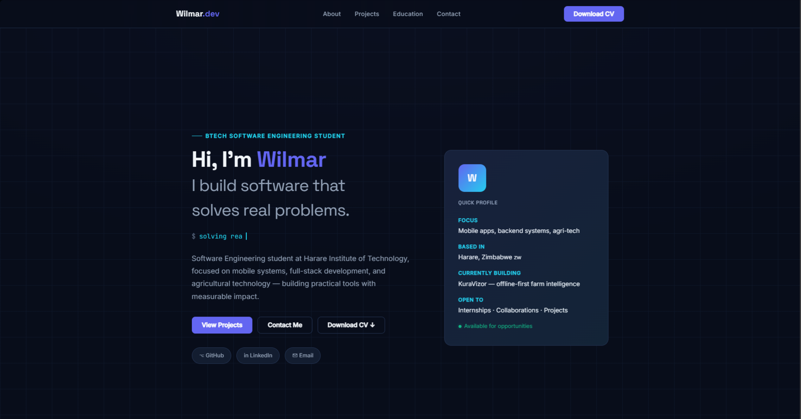

# Wilmar Macheke — Portfolio

> Personal portfolio website built with React. Showcases projects, skills, and background as a Software Engineering student at Harare Institute of Technology.

**Live site:** [axecrow-12.github.io/portfolio](https://axecrow-12.github.io/portfolio/) &nbsp;·&nbsp; **Author:** [Wilmar Macheke](https://github.com/axecrow-12)

---

## Preview



---

## Tech Stack

| Layer | Technology |
|-------|-----------|
| Framework | React 19 |
| Styling | Plain CSS (custom properties, no UI library) |
| Animations | CSS transitions + IntersectionObserver |
| Fonts | Space Grotesk · Inter · JetBrains Mono |
| Build tool | Vite 6 |
| Deployment | GitHub Pages via GitHub Actions |

---

## Features

- **Typewriter effect** — cycles through what I do (static text when reduced motion is on)
- **Grouped skills** — Mobile, Web & Backend, Data, Machine Learning, Tooling
- **Project filter** — filter projects by technology, with live, built and in-progress badges
- **Scroll progress bar** — indigo/cyan gradient fixed to the top of the viewport
- **Scroll reveal animations** — sections fade up as they enter view
- **Social previews** — Open Graph and Twitter card metadata
- **Accessible** — skip link, keyboard focus styles, labelled filter buttons, screen-reader text
- **Responsive layout** — works across mobile, tablet, and desktop
- **Reduced motion support** — respects `prefers-reduced-motion`

---

## Projects Featured

| Project | Status | Stack |
|---------|--------|-------|
| [Level Up Lounge](https://level-up-lounge-weld.vercel.app) | Live | React, Spring Boot, PostgreSQL, WebSockets |
| [Sparkle & Slay](https://sparkleandslay.net) | Live | JavaScript, PHP, MySQL, EcoCash API |
| [Pique Squid Cyber](https://cyber.piquesquid.com) | Live | HTML, CSS, Bootstrap 5 |
| [FarmRoute](https://github.com/axecrow-12/farm-route) | Built | Java, Android, TensorFlow Lite |
| SmartPay Shield | Built | Node.js, Python, FastAPI, LightGBM |
| ICLPSM CMS | In progress | Laravel, PHP, MySQL |
| [LocationTracker](https://github.com/axecrow-12/LocationTracker) | Built | Java, Android, Room, Google Maps API |
| [KuraVizor](https://github.com/axecrow-12/kuravisor) | In progress | TypeScript, React, PostgreSQL, Prisma |
| [Agrovia 2.0](https://github.com/axecrow-12/Agrovia_2.0) | Concept + build | React, Spring Boot, MySQL |

---

## Getting Started

### Prerequisites

- Node.js 18+
- npm or yarn

### Installation

```bash
# Clone the repo
git clone https://github.com/axecrow-12/portfolio.git
cd portfolio

# Install dependencies
npm install

# Start the dev server
npm run dev
```

The site runs at `http://localhost:5173` by default.

### Build for production

```bash
npm run build
```

Output goes to `dist/`. To test the GitHub Pages base path locally in Git Bash, run `MSYS_NO_PATHCONV=1 BASE_PATH=/portfolio/ npm run build` (without the prefix, Git Bash rewrites the path). Deploy the contents of that folder to any static host.

---

## Project Structure

```
src/
├── data/content.js     # All site content: projects, skills, education, links
├── components/         # Nav, Hero, About (+ Skills), Projects, Contact (+ Footer), Reveal, Icons
├── hooks.js            # useTypewriter, useScrollProgress, useReveal
├── App.jsx             # Page composition
├── App.css             # Design system, layout, and component styles
└── main.jsx            # React entry point

public/
├── Wilmar-CV.pdf       # CV linked from the nav and hero
├── og-image.png        # Social preview image
└── favicon.svg
```

---

## Customisation

All content lives in `src/data/content.js` in plain arrays — no CMS. To update:

- **Projects** — edit `projects` (`status` picks the badge colour: Live, Built, In Progress, Concept + Build)
- **Skills** — edit `skillGroups`
- **Education** — edit `education`
- **Typewriter phrases** — edit `phrases`
- **Contact links** — edit `links`
- **CV file** — replace `public/Wilmar-CV.pdf`

The hero's "Currently building" line is generated from projects marked `In Progress`.

Colors are defined as CSS custom properties in `:root` inside `App.css`.

---

## Deployment

The site deploys to **GitHub Pages** automatically through GitHub Actions (`.github/workflows/deploy.yml`).

| Branch | Role | What happens on push |
|--------|------|----------------------|
| `main` | Production | Lint, build, deploy to GitHub Pages |
| `staging` | Testing | Lint and build only (no deploy) |
| `feature/*` | Daily work | Pull request into `staging` runs lint and build |

**Flow:** branch from `staging` → open a PR into `staging` → merge → test locally with `npm run build && npm run preview` → PR from `staging` into `main` → live.

The workflow sets `BASE_PATH=/portfolio/` so asset links work under the repo subpath. If the repo is ever renamed to `axecrow-12.github.io` or given a custom domain, change `BASE_PATH` to `/` in the workflow.

### Run locally

```bash
npm ci
npm run dev
```

---

## Contact

- **Email:** axecrow12@gmail.com
- **GitHub:** [github.com/axecrow-12](https://github.com/axecrow-12)
- **LinkedIn:** [linkedin.com/in/wilmar-macheke-597934352](https://www.linkedin.com/in/wilmar-macheke-597934352)

---

© 2026 Wilmar Macheke
